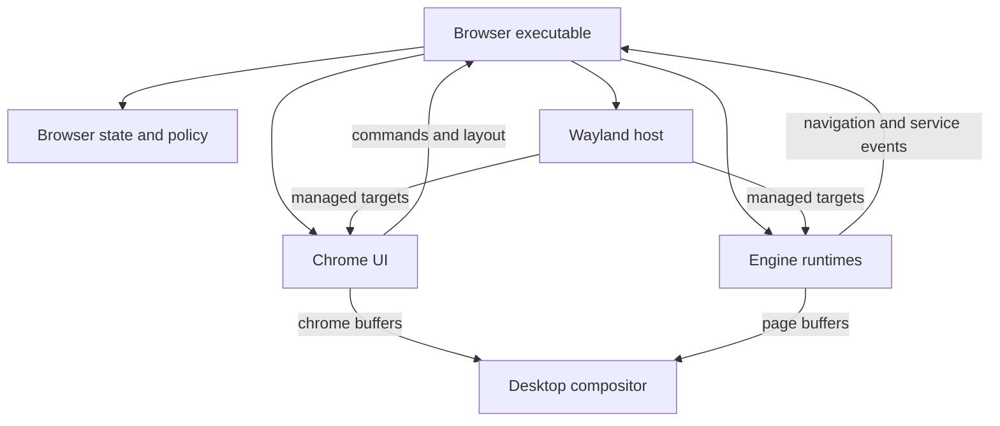

# Sighurt: architecture and rewrite plan

**Status:** proposed design, with implementation gates.  
**Prepared:** 26 September 2026.  
**Target:** a small, configurable, Wayland-only browser host with interchangeable content engines and independently rendered browser chrome.

This plan critiques the preceding conversation, checks the main assumptions against protocols and code, and specifies a structure to implement. It does not claim that the complete integration has been built or benchmarked. The crucial Servo-on-a-subsurface path must be demonstrated before replacing the working browser.

The repository review covered the current workspace, core/browser/page/command/router code, the IPC definitions, Servo's executable/delegate/rendering code, and the Wasm runtime and manifests. The inspected `main` reference was `dbe0813fe5b6744634054ada413315a956fd7536`. This is a focused architectural review, not an exhaustive security audit. Source links and version qualifications are at the end.

**Reading route:** start with sections 1–5 for the decisions and crate structure, then jump to sections 23–24 for implementation order. Sections 6–22 specify the contracts and behavior to consult while coding.

- [Critique and current-code findings](#2-corrections-to-the-previous-advice)
- [Workspace structure](#5-exact-workspace-structure-to-strive-for)
- [Engine and surface contracts](#7-the-engine-contract)
- [Presentation lifecycle](#9-rendering-and-presentation-need-distinct-owners)
- [Engine adapters](#14-servo-adapter)
- [Rewrite milestones](#23-rewrite-milestones-and-decision-gates)
- [Migration map and verification](#24-migration-map-preserve-move-replace)
- [Coding-agent kickoff instructions](#28-rewrite-instructions-to-hand-to-a-coding-agent)
- [Sources](#30-sources-and-evidence-boundaries)

## 1. The decision I recommend

Build Sighurt around **browser state, managed presentation targets, and explicit engine services**.

1. Target Linux and Wayland directly.
2. Start with CPU-rendered chrome in small shared-memory surfaces.
3. Let Servo use its existing GL/GLES renderer, presenting into a dedicated page surface.
4. Let the trusted Wasm engine implementation render its guests through its own renderer; initially use CPU drawing where it is sufficient.
5. Let the desktop compositor combine these surfaces.
6. Keep browser state independent of GPUI, Wayland objects, graphics APIs, and engine implementation types.
7. Compile selected engines into the application for the initial implementation, after proving they can coexist in one process.
8. Treat process placement as a separate decision from rendering and binary packaging.
9. Prove the expensive integration points with small experiments before generalizing interfaces.

The strongest idea is the separation of **what the browser is doing** from **how each visible region is drawn**. Sighurt should not translate Servo's page into a universal Sighurt drawing language. It should give a trusted adapter a controlled destination and receive the browser-relevant information it needs.

There is no need to make every subsystem novel. The useful ambition is a browser whose important mechanisms are understandable, replaceable, and measurable. Standard Wayland mechanisms can support that ambition particularly well.

### What the first usable version contains

One window; multiple tabs; one active content view; a small tab/address/command interface; configurable commands and keybindings; Servo and Wasm as selectable compiled engines; correct input, scaling, clipboard, and lifecycle behavior; useful errors and diagnostics.

### What it postpones

Runtime native plugin loading, a universal scene graph, a custom compositor, Windows/X11 support, arbitrary GPU APIs for downloaded Wasm, general cross-process GPU transport, a new networking stack for Servo, and an immediate replacement for every feature inherited from Oxide.

These are scope decisions for the rewrite. A clearly unsupported feature is better than a claimed feature that only works by accident.

## 2. Corrections to the previous advice

| Earlier idea | Assessment | Decision for the rewrite |
|---|---|---|
| Wayland-only gives a clean target | Sound, given your goals | Use Wayland directly; support its ordinary protocols rather than compositor-specific behavior |
| CPU chrome and GPU pages can coexist | Sound | Separate surfaces and presentation paths |
| Sighurt does not need to draw page pixels | Sound for normal presentation | Keep readback out of the normal display path; screenshots remain a separate optional operation |
| Every engine should hand the core a surface | Ownership is underspecified | The Wayland host creates and manages targets; trusted adapters receive lifetime-bound access |
| Surfaces are the entire engine interface | Incomplete | Add control, input, service requests, and semantic events |
| An external engine can simply hand over a Wayland surface | Incorrect as a general design | Surfaces on independent Wayland connections cannot simply become each other's subsurfaces |
| A subsurface is automatically confined to its page rectangle | Incorrect | The host and adapter must enforce size, placement, viewport, and stacking rules |
| Servo's rendering context makes its renderer arbitrary | Too broad | The inspected API is GL/GLES-oriented; do not plan a Servo Vulkan conversion |
| One executable implies one process | Incorrect | A binary can run worker modes; packaging and process isolation are independent |
| Removing IPC is the main performance win | Unproven | First remove page readback, bulk frame transport, and re-upload |
| Wasmtime makes process isolation unimportant | Too optimistic | Guest sandboxing still depends on the runtime and exposed host capabilities |
| Raw Wayland is inherently better than SCTK | Not established | Use direct Wayland with selective helpers when they reduce bugs without dictating UI policy |
| The result is automatically minimal or faster | Unproven | Measure idle cost, page copies, responsiveness, memory, dependencies, and maintenance burden |

Wayland's subsurface specification explicitly allows children to extend beyond their parent's area. Its object model also does not provide a general cross-client surface-adoption mechanism. `xdg-foreign` establishes relationships between top-level windows; it is not an embedded-page protocol. These constraints change the interface design materially. [W1, W2, W7]

The previous phrase “Sighurt owns policy, engines own pixels” remains useful **as an ownership guideline**. It is not a claim that an in-process engine is technically prevented from violating policy.

## 3. What the current code tells us

The present architecture has useful boundaries, but GPUI and presentation responsibilities still reach into the core.

| Inspected code | Finding | Rewrite consequence |
|---|---|---|
| `sighurt-core/Cargo.toml` and `src/browser.rs` | The core depends on GPUI and uses its entities, contexts, subscriptions, and tasks | Extract ordinary Rust state and explicit effects, rather than merely replacing imports |
| `sighurt-core/src/commands.rs` | Commands are registered through GPUI types | Preserve command names and behavior; replace the UI-specific binding machinery |
| `sighurt-core/src/page.rs` | One module hosts processes, handles engine messages, and paints frames/draw lists through GPUI | Split control, runtime hosting, and presentation responsibilities |
| `sighurt-ipc/src/lib.rs` | The protocol mixes browser events, raw pixel frames, draw operations, and image resources | Preserve the useful semantic vocabulary; remove the assumption that pixels travel with control messages |
| `sighurt-engine-servo/src/rendering.rs` | A GPU context is read into CPU RGBA memory; rows are flipped; normal `present` does nothing | Replace the display transport, while retaining useful rendering-context knowledge |
| `sighurt-engine-servo/src/main.rs` | Frames are painted, read, compared with the previous full frame, and transmitted when changed | Replace pixel comparison with invalidation/readiness and normal presentation |
| Servo's executable and delegate | Process-exit paths and a shutdown watchdog assume Servo owns its process | These must be removed or reworked before linking the engine into the browser |
| `sighurt-core/src/router.rs` | HTTP routing can perform a separate HEAD/GET MIME probe | Reconsider routing without duplicating Servo's authenticated network behavior |
| `sighurt-core/src/browser.rs` | Cross-engine navigation is reconciled with engine history using URL-based heuristics | Define explicit ownership of history and navigation identities |
| Wasm engine manifest/runtime | There is already substantial runtime, capability, media, and event infrastructure | Preserve selectively; do not confuse changing the shell with needing to rewrite the entire guest ecosystem |

These observations come from the inspected code, not performance measurements. [R1–R9]

### The concrete performance opportunity

For a 3440 × 1440 RGBA frame:

`3440 × 1440 × 4 = 19,814,400 bytes ≈ 18.9 MiB`

At 100 frames/second, one complete traversal of that pixel payload represents about **1.98 GB/s**. That is arithmetic, not a measurement of Sighurt's actual throughput. A smaller page area reduces it; a static page does not send that much. Readback, comparison, transport, and upload may each add work.

The target is therefore specific: **normal Servo presentation should neither read the page back into a CPU array nor upload that array through a second UI renderer.** Achieving this does not prove zero copying in drivers or the compositor, nor guarantee direct scanout.

A separate process could also avoid bulk CPU copies through shared buffers. An in-process implementation can still be slow if it retains readback. Keep those two decisions separate.

## 4. The system's layers

Use four responsibilities, with the executable wiring them together.

| Layer | Owns | Does not own |
|---|---|---|
| Browser core | Tabs, engine selection, commands, navigation coordination, permission decisions, session state | Windows, surface proxies, glyphs, GPU contexts |
| Chrome implementation | Address editing, command UI, chrome layout, widget interaction, chrome drawing | Web layout, Servo internals, guest permissions |
| Wayland host | Connection, roles, target lifetime, placement, scaling, input normalization, presentation scheduling | DOM layout, guest execution, engine-specific rendering |
| Engine adapter/runtime | Content interpretation, content execution, engine-local state, content rendering, engine event translation | Browser-wide tab policy, unrestricted control of chrome, global command execution |

The desktop compositor is external to Sighurt and combines the submitted surfaces.



This diagram shows responsibilities and runtime interaction, not Cargo dependencies.

### Avoid turning the core into a new framework

The core does not need a generic UI tree, a virtual DOM, a plugin framework, or an all-purpose event bus. An ordinary state object receiving typed actions and producing a short list of effects is enough.

The chrome computes its layout. The host validates and applies a placement snapshot. The core knows which tab is active and which view belongs to it; it need not understand glyph geometry or how many Wayland objects realize that view.

## 5. Exact workspace structure to strive for

Keep the existing top-level crate naming style. Add only boundaries that have a concrete job.

| Crate | Contents | Allowed project dependencies |
|---|---|---|
| `sighurt-api` | IDs, typed commands/events, input data, geometry units, view options, capability declarations, engine contract | None |
| `sighurt-core` | Browser state, command interpretation, routing policy, navigation coordination, permission policy, session model | `sighurt-api` |
| `sighurt-wayland` | Wayland connection and dispatch, target leases, SHM presentation, surface graph, scaling, input, frame scheduling | `sighurt-api` |
| `sighurt-ui` | Chrome state, layout, hit testing, text editing, CPU painter, optional later GPU painter | `sighurt-api`, `sighurt-wayland` |
| `sighurt-engine-servo` | One Servo runtime, WebView management, Servo events, GL presentation adapter | `sighurt-api`, `sighurt-wayland` |
| `sighurt-engine-wasm` | Wasmtime, guest capabilities, execution scheduling, guest draw implementation, presentation adapter | `sighurt-api`, `sighurt-wayland` |
| `sighurt-browser` | `sig` executable, configuration loading, factories, event loop, effects, persistence and OS-service integration | All selected host crates |
| `sighurt-sdk` | The guest-facing Wasm API and convenience functions | Keep independent of native browser/UI/platform crates |

`sighurt-api` is an internal Rust contract rebuilt with the workspace. It is not a stable native plugin ABI. The guest SDK is a separate compatibility promise.

Suggested files:

| Directory | Modules |
|---|---|
| `sighurt-api/src/` | `ids.rs`, `geometry.rs`, `input.rs`, `engine.rs`, `events.rs`, `services.rs`, `commands.rs` |
| `sighurt-core/src/` | `state.rs`, `tabs.rs`, `navigation.rs`, `router.rs`, `commands.rs`, `permissions.rs`, `config.rs`, `session.rs` |
| `sighurt-wayland/src/` | `connection.rs`, `window.rs`, `targets.rs`, `placement.rs`, `scale.rs`, `input.rs`, `text_input.rs`, `clipboard.rs`, `scheduler.rs`, `shm.rs` |
| `sighurt-ui/src/` | `state.rs`, `layout.rs`, `hit_test.rs`, `text_edit.rs`, `chrome.rs`, `paint_cpu.rs`, `accessibility.rs` |
| `sighurt-engine-servo/src/` | `lib.rs`, `runtime.rs`, `view.rs`, `delegate.rs`, `presentation.rs`, `input.rs`, `navigation.rs` |
| `sighurt-browser/src/` | `main.rs`, `app.rs`, `effects.rs`, `registry.rs`, `services.rs`, `persistence.rs`, `diagnostics.rs` |

Keep the Wasm modules that already have coherent responsibilities; do not rename every file for symmetry. Split shared text/raster helpers into another crate only after UI and Wasm actually duplicate significant code. Small direct dependencies are preferable to a premature platform-neutral framework.

### Dependency rules

- `sighurt-core` must compile and test without GPUI, Wayland, Servo, Wasmtime, or a graphics driver.
- `sighurt-api` must not contain `gpui::Entity`, `wl_surface`, `Rc<Servo>`, `ash::Device`, or a generic `Any` escape hatch.
- Only the executable chooses which engine and UI implementations are installed.
- Engines communicate outward through typed events and service requests, not a mutable reference to the whole browser.
- UI rendering choices must not change tab/navigation state types.
- Move network and filesystem effects out of the pure core. Configuration parsing and pure validation may stay.

## 6. State and identity

Keep these concepts separate:

| Identity | Meaning | Lifetime |
|---|---|---|
| `WindowId` | A browser window | From open to close |
| `TabId` | The user's persistent tab | Across navigations and engine switches |
| `ViewId` | One engine-owned content view | Until that engine view closes |
| `NavigationId` | One requested navigation or traversal | Until committed, cancelled, or failed |
| `DocumentGeneration` | Which committed document/capability context is active | Changes when its authority changes |
| `TargetId` | A host-managed presentation destination | May outlive a single document |
| `LayoutEpoch` | One authoritative placement/size/scale snapshot | Changes when presentation geometry changes |
| `RequestId` | A permission, clipboard, picker, or other asynchronous request | Until answered or cancelled |

Use opaque newtypes and either monotonically increasing IDs or generation-tagged storage. Never use a tab's vector index as its durable identity. A late response from a closed view must not affect a new view that occupies the same slot.

Separate the URL the user is editing, the requested URL, and the committed URL. An unfinished navigation must not falsely update the address bar's committed security identity.

### One source of truth per field

The core owns active tab, tab order, navigation coordination, and policy. An engine owns its document and engine-native history. The UI owns edit-buffer selection and temporary widget state. The host owns current surface metrics and presentation state. Engines report facts; they do not mutate core fields directly.

Suggested core entry point, as a design sketch:

```rust
fn update(state: &mut BrowserState, event: BrowserEvent) -> Vec<Effect>;
```

Effects describe actions such as opening a view, sending a navigation, writing a session snapshot, or requesting an OS service. They do not execute I/O inside `update`.

No event sourcing database or functional-programming framework is required. This is simply a way to make state changes inspectable and testable.

## 7. The engine contract

The full boundary has four parts:

1. **Control:** open, navigate, reload, stop, traverse, set visibility, focus, close.
2. **Presentation:** a managed target, its current metrics, and permission to present a frame.
3. **Services:** permission checks, clipboard, file pickers, downloads, and other privileged actions.
4. **Semantics:** title, committed URL, navigation state, cursor, text-input state, accessibility, and failures.

A surface is the rendering boundary. It is not the entire browser-engine boundary.

### Proposed Rust shape

The following is interface pseudocode. Names and signatures are proposed Sighurt APIs, not existing Servo APIs or a claim of compiling code. Finalize them after the first two engines exercise the same lifecycle.

```rust
pub trait EngineRuntime {
    type Target;
    type FramePermit;

    fn open_view(
        &mut self,
        view: ViewId,
        options: ViewOptions,
        target: Self::Target,
    ) -> Result<(), EngineError>;

    fn command(
        &mut self,
        view: ViewId,
        command: EngineCommand,
    ) -> Result<(), EngineError>;

    fn pump(&mut self, events: &mut Vec<EngineEvent>) -> PumpStatus;

    fn present(
        &mut self,
        view: ViewId,
        permit: Self::FramePermit,
    ) -> Result<PresentOutcome, EngineError>;

    fn close_view(&mut self, view: ViewId);
}
```

The executable binds associated types to `sighurt_wayland::TargetLease` and `sighurt_wayland::FramePermit`. The core only sees IDs, commands, and events. Associated types express a real distinction between neutral browser control and a native presentation attachment; they are not a promise of universal portability.

Successful command/open return values mean the request was accepted, not that navigation or loading has finished. Expensive initialization uses workers where the engine permits it and emits readiness/failure events. Document any unavoidable owner-thread initialization cost. `pump` must report pending work/deadlines so the host can decide whether to sleep; it does not promise to preempt engine internals.

Do **not** require `Send + Sync` on this trait. Servo and its window rendering context are thread-affine in the inspected API. Do not use unsafe `Send` implementations to make a generic executor accept them. [S2, S4]

Use one runtime per engine kind with multiple views. Do not mechanically turn the current one-process-per-page Servo setup into one independent Servo initialization per tab.

### Command and event vocabulary

| Direction | Representative values |
|---|---|
| Host to engine | `Navigate`, `Reload`, `Stop`, `Traverse`, `SetMetrics`, `SetVisibility`, `SetFocus`, `Input`, `ResolveServiceRequest`, `Close` |
| Engine to host | `ViewReady`, `NavigationStarted`, `NavigationCommitted`, `NavigationFailed`, `HistoryChanged`, `TitleChanged`, `FrameReady`, `CursorChanged`, `TextInputChanged`, `ServiceRequested`, `NewViewRequested`, `ViewClosed`, `ViewFailed`, `RuntimeFailed` |

Every view event carries `ViewId`. Navigation events carry the relevant navigation identity or an adapter-assigned identity for engine-initiated navigation. Requests tied to document authority carry its generation. A callback is queued and handled after the current engine call returns, avoiding reentrant mutation of the browser.

`FrameReady` means the engine has something new to paint. It is not evidence that pixels reached the monitor. Keep production, submission, and display feedback as distinct events.

### Capability declarations

Report supported operations explicitly: history traversal, text input, accessibility, screenshots, find-in-page, page zoom, pointer lock, and native popup requests. Unsupported operations return a typed result; they do not silently succeed.

Avoid a giant capability framework initially. A small typed struct and enums are enough. The core uses capabilities to choose behavior; the UI uses them to explain availability.

## 8. Surface ownership and the concrete window

The Wayland host creates the root window and all native surfaces used by Sighurt's chrome and page views. It owns role assignment, parent-child relationships, placement, stacking, and destruction coordination. Trusted presentation adapters receive a **target lease** rather than creating arbitrary unrelated top-level windows.

For one window, use this surface layout:

| Surface | Parent/role | Producer | Initial lifetime |
|---|---|---|---|
| Window root | `xdg_toplevel` role | Static host background | Entire window lifetime |
| Chrome | Subsurface of root | CPU chrome painter | Entire window lifetime |
| Page view | Subsurface of root | Selected engine's presenter | Lifetime of that live view; mapped only when selected |
| UI overlay | Subsurface of root, above page/chrome as appropriate | Trusted chrome implementation | While an overlay is needed |
| Additional engine plane | Explicit host-approved subsurface | Trusted engine adapter | Deferred until a concrete use requires it |

A genuine native popup has its own xdg-shell rules and is not automatically another arbitrary child plane. Most page content remains within one page surface.

### Root

The root is a stable window anchor and opaque fallback background. Map it correctly through xdg-shell's configure handshake. Keep it alive while children are visible. Set window geometry intentionally.

Initially, a full-window solid SHM buffer that changes only on resize is acceptable. When `wp_viewporter` is available, a tiny solid buffer scaled to the window can reduce that allocation. This is an optimization of a static background, not a reason to require a full-window CPU paint every time a page animates. [W3, W4]

### Chrome

Use one small surface for the top chrome. Add a separate bottom status strip only if the UI actually needs it. Buttons, text, tabs, and icons inside a strip are widgets painted into that strip, not individual Wayland surfaces.

### Page

Give each live engine view a target whose lifetime is stable while that view exists. Initially display only the active view. Hidden views remain engine state, not an ever-growing stack of active render loops. The platform-specific presenter must explicitly implement hiding and remapping; GPU window-system integration cannot be treated as a generic CPU buffer operation.

For the first iteration, keep tab targets attached to their original window. Do not support moving a live WebView between windows until its context and target rebinding have been tested. This avoids making a theoretical API promise that the pinned engine cannot satisfy.

### Overlays

An in-window command palette or permission panel can use a bounded overlay subsurface above the page. Its input region covers only what it should receive. A transparent pixel does not by itself mean pointer events pass through.

Use `xdg_popup` for a genuine popup window only when its placement/grab rules are needed. A web `window.open` request is a browser policy event, not automatic authority to create a desktop popup.

### Limits of this composition model

Standard subsurfaces are a good match for rectangular browser regions. They are not a general-purpose graphics scene graph. Arbitrary rotations, page-to-chrome blur, rounded clipping across independently drawn regions, and complex cross-surface effects may require extra rendering or another composition path. Avoid requiring those effects in the initial UI.

Native adapters cooperate with these rules. In-process access to a raw Wayland pointer is not an enforceable security boundary. Untrusted Wasm receives no such pointer.

## 9. Rendering and presentation need distinct owners

Rendering produces pixels. Presentation makes a finished image available to the desktop. Each engine may choose its renderer, but it still participates in a common lifetime and scheduling contract.

| Operation | Authority |
|---|---|
| Create a window or assign a surface role | Wayland host |
| Choose page rectangle and stacking | Validated UI layout applied by the host |
| Choose scale and target buffer dimensions | Host metrics policy, informed by compositor events |
| Draw the content | Content renderer |
| Allocate a CPU chrome buffer | SHM presenter |
| Acquire a GL/Vulkan presentation image | The appropriate graphics presentation adapter |
| Submit a CPU buffer | SHM presenter under the host scheduler |
| Swap a GL window / present a Vulkan swapchain image | The adapter owning that window-system integration path |
| Release or reuse storage | The owner, after the required release/synchronization condition |
| Destroy native objects | Host and presenter through the close protocol |

**Do not let both the host and a GL/Vulkan adapter independently commit buffer state on the same leaf surface.** A graphics driver's presentation operation may already perform the relevant Wayland commit. The host prepares geometry state; the leaf's selected presenter owns buffer submission. Root commits used for layout transactions remain the host's responsibility.

### Target lease

A target lease represents an allocated host destination and keeps its native backing alive. It provides:

- A stable target identity and current view generation.
- Current logical size, buffer size, scale, and layout epoch.
- A controlled way to obtain the platform handles required by trusted GL/Vulkan code.
- A presentation mode selected during attachment: SHM or a native graphics presentation path.
- A documented shutdown order and a way to retire the target.

Avoid a public `fn surface() -> WlSurface` as the whole interface. It says nothing about role ownership, lifetime, geometry authority, commit ownership, or shutdown.

Rust's type system can prevent many accidental ownership errors, but borrowed native handles often rely on explicit unsafe lifetime guarantees. Keep those guarantees in the presentation adapter, document them, and test destruction ordering. Do not scatter pointer conversions through engine or browser code.

For Rust Wayland FFI, use the appropriate system/libwayland backend. `wayland-client` specifically documents this requirement for `raw-window-handle` interoperation. An arbitrary Rust-side proxy or numeric object ID is not a valid substitute for a native `wl_surface*`. [L1]

### Frame permit

Make permission to submit a frame specific to a view and layout epoch. A permit records the geometry the renderer is expected to use and is consumed by one presentation attempt. It is not `Clone`.

After an asynchronous renderer finishes, check the view generation and layout epoch again. A result for a closed view or superseded size is discarded or explicitly retained as a temporary old-size image according to the resize policy. It is never silently treated as current.

This is a cooperative host contract. It cannot stop malicious native code that already holds raw graphics/Wayland handles.

## 10. Frame scheduling, resizing, and buffer lifetime

### Three different signals

Keep these concepts separate in both code and diagnostics:

| Signal | Meaning | What it does not establish |
|---|---|---|
| Engine invalidation / `FrameReady` | Content needs painting | That display timing permits another frame |
| Wayland frame callback | An opportunity to schedule another frame | That the previous buffer is safe to overwrite or was displayed at an exact timestamp |
| Buffer release / graphics synchronization completion | Storage is no longer in use under that path's rules | That a new frame is needed |

Use presentation-time feedback for measurements when available. Keep the graphics driver's acquisition and synchronization mechanisms intact. [W1, W8, W9]

### Normal scheduling policy

Render a view when it is visible, it has pending work, and its presenter can accept that work. Retain the latest invalidation while throttled; do not accumulate a queue of obsolete pictures.

For chrome, redraw after an edit, hover change, tab metadata change, configuration change, caret deadline, or layout change. A static strip needs no continuous tick. Caret timers stop when the relevant editor is unfocused.

Use Wayland frame callbacks to pace application-driven animation. Bootstrap the first frame after creation or remapping without waiting for a callback that cannot exist until a buffer has been committed. Similarly, do not wait forever on a callback withheld for an invisible surface.

Do not render chrome because Servo produced a new frame. Do not spin Servo only because chrome's caret blinked. These systems share a coordinator, not a mandatory frame loop.

### Subsurface commit policy

Use desynchronized leaf updates during ordinary independent animation. Treat layout changes as host-controlled transactions using synchronized child commits where necessary. Positions and stacking still require the appropriate parent commit. [W1]

Proposed resize sequence:

1. Collect the latest applicable window configuration and acknowledge it according to xdg-shell rules.
2. Compute a complete placement snapshot and allocate a new `LayoutEpoch`.
3. Temporarily coordinate affected children for the layout transaction; pause submissions using the superseded epoch.
4. Inform presenters of the new metrics. Reallocate buffers or resize native presentation windows as required.
5. Obtain valid content for changed regions, or choose the explicit fallback described below.
6. Apply child positions, viewport state, input regions, and prepared child submissions; commit the parent to expose the coherent placement.
7. Resume independent leaf presentation and process any newer pending configuration.

The implementation must account for the fact that a native swap may commit its own child surface. Never assume that changing a Rust struct automatically changes compositor state. The prototype must test this sequence using the actual pinned Servo/Surfman stack.

### Slow resize fallback

Do not block input or the entire event loop while waiting for a slow page repaint. Keep the last valid frame until a short, measured grace period expires. After that, either scale it to the new rectangular target using a tested viewport configuration, or unmap the page leaf and show the root fallback until a correct frame arrives.

Start with the simpler fallback of hiding the stale page when necessary. Treat scaled old content as an optional improvement. Its input mapping must agree with what is visibly displayed; disabling page interaction during the brief placeholder state is safer than sending clicks to a mismatched layout.

Do not promise a hard timeout can preempt a blocking in-process Servo call. Timers help only while control returns to the event loop. That limitation belongs in the process-placement decision.

### SHM buffer rules

Start with two buffers for each small chrome surface and allow a bounded third buffer when justified. Track each buffer as free, being drawn, or submitted. Reuse submitted storage only after release. If no buffer is available, retain the invalidation and wait; never overwrite in-use memory.

On resize, retire the old pool generation and retain storage that is still in use. Bound the number and total bytes of retiring generations. Repeated resize must not create an unlimited allocation stream.

For the first implementation, repaint the complete **small chrome buffer** whenever it changes. This avoids stale contents when alternating between buffers. Add partial repaint only with a sound buffer-content/damage-history model. Advertising a damage rectangle does not initialize the rest of a newly chosen buffer.

Pixel format is explicit. Wayland SHM ARGB/XRGB layouts and `tiny-skia`'s premultiplied RGBA memory are not automatically interchangeable. Verify channel order, endianness, stride, and premultiplication; use a controlled conversion if needed. A small chrome swizzle is acceptable. A full-page readback on every frame is the path being removed. [W1, L4]

## 11. Geometry, scale, and input coordinates

Define units in types or in unambiguous type names:

| Unit | Used for |
|---|---|
| Window logical coordinates | Chrome layout and child placement |
| Surface-local logical coordinates | Wayland input and per-target interaction |
| Buffer pixels | Raster dimensions, GPU targets, buffer damage |
| Engine content coordinates | Whatever the pinned engine input API expects |
| CSS/page zoom | A separate engine setting, never a substitute for display scaling |

The host issues a metrics snapshot with the logical rectangle, actual buffer dimensions, scale, and epoch. The adapter converts from that snapshot into its engine's types. Do not multiply coordinates by a scale in both the input router and the engine adapter.

For fractional scale, preserve the compositor's rational scale value instead of repeatedly accumulating float rounding. Use the fractional-scale and viewporter protocols together where supported; integer scaling is the fallback. The fractional protocol expresses its numerator over 120. [W4, W5]

Choose and document a consistent buffer-dimension rounding policy, following the negotiated protocol's requirements. Derive input transforms from the actual resulting dimensions rather than assuming the nominal scale maps every rounded edge exactly. Clamp zero-sized layout regions into a hidden state; do not allocate zero-sized GPU surfaces.

Example of the distinction: a page placed at logical y = 64 receives surface-local pointer coordinates relative to its own surface. If Wayland already reports y = 10 on that page, subtracting the chrome's 64 again is a bug. Convert that local point once into the engine's expected coordinate system.

Required checks include 100%, 125%, 150%, and 200% scaling; dragging between differently scaled outputs; odd window sizes; text caret alignment; and pointer hits near the chrome/page boundary. Account for scale changes even when the window's logical size is unchanged.

## 12. Input, focus, clipboard, and text

The host normalizes physical input. The browser decides shortcut policy. The current focus owner receives the remaining interaction.

### Focus model

Track a per-seat logical focus target, such as page, address editor, command editor, or modal UI. Also track compositor keyboard activation separately. Moving focus to the address bar must notify the engine that its page lost focus; losing window activation must stop repeat/capture state as appropriate.

Wayland subsurfaces do not themselves receive keyboard focus. The host must route keyboard events for the focused main window to the correct logical child. IME surface association and caret rectangles must likewise be translated into the coordinate system of the surface the text-input protocol actually uses. Do not wait for a keyboard-enter event on the page subsurface. [W1]

Start by using one active seat in product behavior while keeping the input representation seat-aware. Do not scatter a single global “currently pressed key” through the core.

### Keyboard handling

Keep physical key codes, layout-dependent key values, modifiers, repeat, and committed text separate. Use xkbcommon through a suitable binding/helper for keyboard mapping and compose behavior. Swedish characters, dead keys, and international input must survive the rewrite.

Support a configurable shortcut interpretation: logical key by default, physical key when explicitly requested. Preserve AltGr correctly rather than assuming every modifier combination means Ctrl+Alt shortcuts.

Use this ownership sequence:

1. Window/seat state is updated.
2. A reserved browser command is considered according to the current input mode.
3. The focused chrome editor or page receives unconsumed input.
4. Text is delivered through the appropriate text-input path.

Ensure consumed key presses do not leave unmatched releases or stuck modifier state in the page. Mouse button drags likewise need a stable recipient until release or cancellation, even if the pointer crosses a surface boundary.

### IME and compose

Implement preedit, committed text, surrounding text, selection/cursor information, and caret rectangle updates where the chosen text-input protocol is available. When it is unavailable, retain keyboard/compose input and report the limitation clearly. Do not advertise full IME support from raw key events alone. [W6]

Translation to Servo's pinned input/delegate API is an adapter responsibility. Avoid feeding the same text once through keyboard synthesis and again through IME commit.

### Clipboard and drag-and-drop

The Wayland host owns the relevant seat/protocol objects and serials. Service requests carry MIME types, origin/view identity where applicable, cancellation, and size limits. Transfer data asynchronously so a stalled source cannot freeze the UI.

Distinguish the ordinary clipboard from primary selection. Let the core decide whether content may read/write it; let the platform execute the permitted operation. Do not give arbitrary guest code unrestricted clipboard access merely because a host function exists.

Treat drag-and-drop as a related but separate capability. File drops are not permission for unrelated filesystem reads.

## 13. Chrome implementation

Use `cosmic-text` for shaping, font fallback, text layout, and rasterization/editing support; use a small painter or `tiny-skia` for rectangles, images, and paths. These are building blocks, not a substitute for focus, selection, input policy, or the rest of an editor. [L3, L4]

Keep four internal concepts:

- A read-only browser snapshot containing the information chrome displays.
- `ChromeState` for temporary interaction and editing.
- A layout result containing regions and hit targets.
- A painter consuming those results for the current target metrics.

An address editor needs cursor movement, selection, deletion, paste, horizontal scrolling, IME composition, and sensible Unicode boundaries. Do not implement editing by indexing UTF-8 bytes. Reuse the text library's editing/cluster information where appropriate.

Start with explicit layout for a tab strip, address/command line, and page rectangle. Do not build a general layout language. Add Taffy only if actual configurable UI complexity warrants it.

Cache font discovery, shaped text where useful, and rasterized glyphs. Set explicit cache budgets. Changing scale or font configuration invalidates the relevant cache entries. A bounded cache is more important than a theoretically perfect one.

### Optional GPU chrome

First stabilize the chrome model, layout, input behavior, and target lifecycle. A later GPU painter can reuse those pieces and present into the chrome target. It must satisfy the same visibility, metrics, scheduling, and shutdown contract.

A small internal chrome paint list may be useful for that replacement. Keep it specific to chrome and any deliberately compatible Wasm drawing implementation. Do not require Servo or every future engine to emit it.

Prefer selecting a chrome presenter at startup. Live CPU/GPU switching adds target teardown and state migration without proving a core architectural benefit. It can come later.

## 14. Servo adapter

The first Servo goal is narrow: present a real WebView on a Wayland child surface without per-frame CPU readback.

### Version reality

The inspected Sighurt manifest uses Servo `0.5`, Surfman `0.13`, and a custom rendering context adapted from the corresponding paint API. The current upstream documentation inspected during research identifies Servo `0.6.0`. Do not silently code against those current docs while retaining the older dependency. Choose a pinned revision in milestone M0, then use its source and examples consistently. [R3, S1–S4]

The documented `RenderingContext` is GL/GLES-oriented. A `WindowRenderingContext` consumes native display/window handles and creates its graphics presentation context. This supports the proposed integration direction; it does not prove every handle, driver, lifetime, and scheduling detail works with Sighurt's proposed target. [S2, S3]

### Prototype path

1. Create the root and page subsurface in the host's connection.
2. Provide valid, lifetime-backed Wayland raw display/window handles for that page surface.
3. Try the pinned Servo `WindowRenderingContext`/Surfman path against those handles.
4. Create one WebView and make the GL context current as required.
5. Integrate Servo's event-loop waker.
6. On frame readiness and a valid presentation opportunity, paint and present.
7. Exercise resize, scale change, hide/show, WebGL, and destruction.

Prefer the existing window rendering context if it works. If it does not, first identify the precise missing integration behavior. A narrow custom context may be justified. Do not immediately write a DMA-BUF export stack, switch Servo to Vulkan, or rewrite its renderer.

Keep software output or the existing readback path only as an explicitly diagnosed fallback while developing. The optimized path must be visible in diagnostics so a fallback cannot make a “success” test misleading.

### Runtime ownership

Use one process-wide Servo runtime in the first host and one WebView per live Servo view. Keep its API calls and GL presentation on the required owner thread. “Owner thread” does not mean Servo internally runs JavaScript, networking, layout, and rendering on one thread; the existing project's wording must not be read that way.

Servo's waker schedules an eventual engine pump. Clear/coalesce wake state with a pattern that cannot lose a wake arriving while work is being processed. Queue delegate events for the outer application loop. Do not mutate the tab list recursively inside Servo callbacks. [S1]

### Required library conversion

- Turn `main.rs` orchestration into an owned runtime with initialization and shutdown methods.
- Replace stdin/stdout control plumbing with direct typed commands/events for the in-process path.
- Remove adapter calls to `process::exit`, `_exit`, and process-wide panic/logging setup that assume exclusive ownership.
- Initialize shared facilities such as tracing and TLS-provider policy from the executable.
- Separate per-view failure from loss of the shared Servo runtime.
- Preserve profile semantics and avoid multiple runtimes racing to write the same profile.
- Keep the existing MPL notices on adapted source files that remain.

If Servo suffers a failure that cannot safely recover in the same process, report it honestly and offer the available recovery action. Do not promise that dropping and reconstructing its Rust wrapper resets all engine-global state.

### Integration features to retain explicitly

Navigation callbacks, same-document navigation, title/load status, cursor and hovered URL, new-view requests, focus, zoom, text input, clipboard delegation, downloads, and permission requests all need named adapters. Their availability must be verified in the selected Servo revision. A rendered webpage alone is not a complete embedder.

## 15. Wasm adapter and guest compatibility

Preserve the distinction between **trusted native engine code** and **downloaded guest code**.

The trusted Wasm engine chooses a rendering implementation and owns the target lease. A guest receives versioned drawing/interaction capabilities, never the native Wayland connection, the chrome target, raw pointers, or unrestricted Vulkan calls.

### Initial rendering choice

The current SDK already supplies drawing operations. Move their native implementation into the Wasm adapter, where they can be painted into that engine's own CPU surface. If CPU rendering is insufficient for an existing guest, port the needed drawing path to a GPU renderer behind the same guest contract.

That renderer independence belongs inside the Wasm engine. The browser core does not need to know whether a guest rectangle became a CPU fill or a GPU draw.

Validate operation counts, geometry, numeric finiteness, nesting/clip limits, image dimensions, and resource IDs. Limit both Wasm memory and host allocations caused by drawing, images, media, network responses, and caches.

### Execution model

Use a shared Wasmtime compilation engine where appropriate and distinct stores/guest state for isolation of guest instances. Compile modules off the UI thread. Initially execute guest callbacks on a bounded worker arrangement, returning validated results/events to the owner loop; native presentation stays with the target's presenter.

Keep calls for one guest ordered. A guest's drawing output, navigation request, and destruction must not race unsafely across worker completions. Every completion carries the view/document generation.

Retain fuel limits and add a deliberate interruption/time-budget policy. Fuel or epoch checks do not interrupt a blocked native host call, so host operations also need timeouts, cancellation, and bounded work. The existing runtime replenishes fuel for calls; a flood of individually bounded callbacks still needs a total scheduling budget. [R8, T1, T2]

Do not build a universal async runtime for everything. Retain Tokio within networking/media components that need it, and use bounded messages/wakeups to communicate with the application loop.

### Animation and visibility

For a guest that uses the existing `on_frame` contract, continue delivering compatible animation callbacks while visible. Coalesce its presented output to display opportunities. A new SDK may add explicit invalidation or animation subscriptions, but do not silently reinterpret old guests' expected callbacks.

Hiding a page can stop presentation without pretending its audio, network activity, or all timers have ceased. Choose and document background policy. If a future suspension mode freezes execution, make that a separate state with explicit resume behavior.

### SDK migration

Keep the existing imports/exports in the first native-shell rewrite wherever possible. Document unsupported capabilities and return errors instead of false success. Version guest-interface breaks independently from the native Rust engine contract.

Do not rewrite media, RTC, storage, cryptography, and guest networking merely to replace GPUI. Audit and narrow their privileges as they are reattached. Avoid unsafe deserialization of arbitrary remote precompiled Wasmtime artifacts; only trust artifacts generated and managed under the runtime's documented compatibility and trust requirements. [T3]

## 16. Navigation, routing, and history

These policies deserve explicit design because rendering independence alone does not make engines interchangeable.

### Routing policy

Use deterministic routing that does not require a second network request for every ordinary webpage:

1. An explicit user engine choice wins, subject to enabled engines and permitted schemes.
2. Trusted internal `sig://` pages are handled by the browser's internal-page implementation.
3. Explicit configured schemes or validated local app files go to their designated engine.
4. Ordinary HTTP(S) browsing goes directly to Servo by default.
5. Wasm applications over HTTP(S) are opened through an explicit app/engine action or a narrowly defined configured rule, then validated by the Wasm loader.
6. Unsupported content becomes a download or a clear error according to the responsible engine's response handling.

The current independent HEAD/GET probe may see different authentication, cookies, redirects, or headers from Servo's real request. It can also add latency. Do not turn it into the foundation of a supposedly universal networking layer. Retain any probing only as an explicit, limited feature with understood semantics. [R7]

Filename extensions are hints for loader selection, not validation of executable content or authority. Redirected Wasm loads must derive origin/permission identity from the actual trusted loading policy and final resource, not a guest-supplied title or manifest claim.

Keep engines responsible for their own content networking initially. The core may broker application-level services, but it does not reimplement Servo's cookies, HTTP cache, redirects, security policy, and all subresource loading. A new transport should integrate through a supported engine facility or an explicit loader path.

### Navigation state machine

Treat navigation as requested, in progress, committed, completed/failed/cancelled. On a new request, retain the current usable view until the replacement is ready or the chosen loading behavior intentionally replaces it.

For engine switches, create the new view/target, validate readiness, and switch visible ownership through the host. Close or retain the old view according to the history policy. A delayed title or permission response from the old view cannot update the newly active document.

Distinguish a failed load from a runtime failure. A malformed URL is not a crashed engine. A page asking to close itself is a policy request, not authority to terminate the browser.

### History ownership

Servo owns the truth of its internal navigation history, including same-document history. Do not reconstruct it solely by comparing URL strings. The current delegate receives more information than the present protocol forwards; use the richest reliable history callbacks available in the pinned revision. [R5, R6]

For cross-engine history, use an outer list of **history segments**. Each segment refers to an engine view and its retained history state, or to a deliberately degraded restore record after eviction.

Proposed behavior:

- Back/forward first traverses the active engine's history when it can.
- At an engine boundary, it activates the adjacent retained segment at its saved cursor.
- Navigating after going back discards the appropriate forward history only when the new navigation commits.
- An internal browser page is its own segment rather than an invented web URL silently inserted into Servo history.
- An evicted segment can be restored by reloading its saved URL, with an explicit loss of document/JS/form state. Never describe that as exact restoration.

For the first implementation, bound retained cross-engine views and test a short sequence thoroughly. Do not attempt complete cross-engine back-forward-cache equivalence. If the selected engine API cannot expose stable history entries, represent that limitation in the adapter instead of manufacturing identifiers from URLs.

## 17. Privileged services and semantics

Define small request/response interfaces for clipboard, downloads, file pickers, external URLs, permissions, and other existing capabilities. Each request contains its actual originating view/document, its operation, required data, and a cancellation identity.

The core decides policy. The executable/platform service performs the allowed effect. The engine adapter converts the result back into engine-specific completion objects. Unknown or unimplemented privileged requests fail closed with a useful error.

For downloaded Wasm, the engine must enforce the grant at the host-function boundary. Do not let a guest grant itself permission by setting a field. For in-process native engines, policy enforcement is cooperative; an exploitable native bug is outside the protection of these Rust interfaces.

### Preserve trustworthy browser UI

Page titles, hovered URLs, and content are untrusted data. Keep them visually contained. A page cannot overwrite the address bar, issue a browser command by navigating to a magic command URL, or trigger a file chooser without the specified policy.

Keep a reliable way to reach browser controls in fullscreen. Coordinate fullscreen and pointer lock as explicit engine requests and release them on the required focus/lifecycle transitions. Add them after the basic input contract works.

### Accessibility

A picture has no button roles, reading order, text ranges, or accessible actions. Keep an explicit semantic path for chrome and engine content. Provide stable IDs and an ownership relationship between the chrome's content container and any engine accessibility subtree.

AccessKit's Unix adapter is a possible bridge for chrome semantics. Its existence does not imply that an arbitrary Servo revision or Wasm guest already supplies a usable accessibility tree. Verify each engine; record unsupported functionality honestly. [L5]

Do not block the first graphics experiment on a complete accessibility implementation. Do preserve the architectural path and include an actual capability assessment before calling the replacement a general daily browser.

### Screenshots and media capture

Separately presented chrome and page surfaces mean there is no single Sighurt framebuffer to read. A page screenshot is an optional engine operation; a full-window screenshot requires deliberate composition of requested captures or a suitable desktop mechanism.

Screen sharing on Wayland should use the desktop portal/PipeWire path where supported. The inherited Wasm `screenshots` dependency is not proof of a complete Wayland capture implementation. Treat capture as a capability to validate, not a feature that automatically survives the shell rewrite. [R8, L6]

## 18. Process placement: the honest tradeoff

Starting with compiled, in-process engines is a reasonable simplification for this experimental browser. It reduces control-transport machinery and can simplify native presentation. It also makes the browser and engine share an address space and fate.

| Question | Initial decision | Independent future decision |
|---|---|---|
| Is the engine compiled into `sig`? | Yes, selected by build features | An external engine may be supported later |
| Is it enabled for new views? | Runtime configuration | Can change without removing compiled code |
| Does it run in the browser process? | Initially yes for the native integration | A worker process can use the same compiled binary |
| Does it share raw pixel data through control messages? | No for normal presentation | Separate shared-buffer transport if needed |
| Is it OS-sandboxed? | Do not claim this for the in-process design | Requires an explicit worker sandbox and resource policy |

Removing a pipe does not make an engine call cheap or interruptible. A hang in an owner-thread call can freeze the UI. A native crash can terminate the entire application. A process boundary permits containment, but a separate process without restricted privileges is not automatically a sandbox.

### Future out-of-process presentation

Do not design it as `send(wl_surface_id)`. Objects on separate Wayland client connections do not become a shared object namespace. Passing or duplicating the live Wayland socket between independent protocol implementations is not a safe shortcut. [W2, W7]

The most compatible future direction is:

1. The browser keeps ownership of its Wayland surfaces.
2. A worker produces shareable image buffers.
3. A transport carries control messages and buffer descriptors separately.
4. A browser-side presenter imports/attaches those buffers and enforces placement.
5. Release/synchronization information returns to the producer so it knows when storage can be reused.

For CPU output this could use bounded shared-memory buffers. For GPU output it may use DMA-BUFs with negotiated formats/modifiers, dimensions, plane offsets/strides, file descriptors, compatible devices, and correct acquire/release synchronization. This is substantial work, especially across drivers and GPUs; it is not a trait-wrapper change. [W8, W9]

A nested compositor is another possible design, but introduces enough responsibilities that it should be considered a separate project milestone. It is unnecessary for the initial same-process host.

The preparation worth doing now is modest: stable IDs, owned messages, bounded queues, explicit failures, a separate presentation adapter, and no assumptions that remote pointers are meaningful. Do not implement unused serialization or speculative transport protocols.

## 19. Event loop and concurrency

Use one application owner loop built with `calloop` or an equivalently small event coordinator. Integrate the Wayland event queue using a supported adapter and the correct prepare-read/dispatch/flush lifecycle. Do not run a hand-written polling loop that occasionally calls blocking roundtrips. [L1, L2, W10]

Sources include Wayland events, engine wakeups, worker completions, asynchronous service results, and timers with actual work to do.

One loop iteration should conceptually:

1. Collect ready input and completion events without unbounded draining.
2. Apply core actions and schedule their effects.
3. Deliver engine commands and pump runtimes that requested work.
4. Queue and apply resulting engine events after engine calls return.
5. Recompute only invalidated chrome/layout state.
6. Perform eligible presentation and layout transactions.
7. Flush outgoing Wayland work and sleep until an event or real deadline.

If processing generates immediately runnable work, arrange another iteration rather than sleeping indefinitely. Bound queue draining so a busy guest cannot starve keyboard input. Coalesce replaceable events such as obsolete pointer motion or frame invalidation; preserve ordered events such as key transitions and navigation commits.

Do not spin every engine on a fixed 60 Hz timer. Engine animation clocks and network activity may still request regular work; the coordinator itself should not manufacture it for an idle browser.

Keep blocking disk access, guest compilation, slow downloads, and native service work off the UI owner thread. Instrument the duration of Servo pumping and graphics presentation. If the selected embedding path blocks for unacceptable periods, reassess thread/process ownership after measuring it; a scheduler cannot preempt an arbitrary native call.

## 20. Lifecycle and shutdown

Use explicit view states such as opening, live-visible, live-hidden, closing, closed, and failed. Rendering readiness and navigation state are separate flags/state machines; do not multiply them into one enormous enum.

The close sequence must:

1. Mark the view closing and revoke new commands/requests.
2. Clear its focus, repeat, pointer capture, and pending modal interaction.
3. Cancel outstanding document-bound service work and invalidate completion generations.
4. Stop animation production and new presentation.
5. Let the engine release view/context resources on the correct thread.
6. Destroy native graphics resources before the native surfaces/connection they use.
7. Retire remaining buffer resources through the presenter's release rules.
8. Remove the view from registries and report closure to the core.

Retain native target backing until all legitimate leases are gone. Do not rely on incidental Rust field-drop order for an FFI lifetime invariant without making the ordering explicit.

At application shutdown, stop creating work, write session state atomically, close views, shut down runtimes, and then release platform objects. Do not transplant the Servo worker's `_exit` watchdog into a shared library. A forced termination, if ever necessary, belongs to an explicit whole-application recovery policy.

A Wayland protocol error can invalidate the shared connection. Handle it as an application/platform failure with useful diagnostic context. It is not necessarily an isolated page error.

## 21. Build features, configuration, and Nix

Make engines optional dependencies of the executable. Keep the core and chrome development loop independent of Servo's full build.

Proposed build modes:

| Mode | Purpose |
|---|---|
| Core tests | No display, engines, or graphics |
| CPU chrome + demo engine | Fast UI and Wayland iteration |
| CPU chrome + Servo | Primary web integration |
| CPU chrome + Wasm | Guest compatibility work |
| CPU chrome + Servo + Wasm | Normal experimental browser |
| GPU chrome + selected engines | Later renderer experiment |

Illustrative future commands, after the proposed feature names exist:

```sh
cargo test -p sighurt-core
cargo run -p sighurt-browser --no-default-features --features engine-demo
cargo run -p sighurt-browser --no-default-features --features engine-servo
```

Cargo features determine what is available in the build. Runtime configuration determines what may be used. A linked optional engine need not initialize until first use. “One executable” does not imply every native library or graphics driver is statically linked. [L7]

Proposed configuration, not existing syntax:

```toml
version = 1

[ui]
renderer = "cpu"

[engines]
default = "servo"
enabled = ["servo", "wasm"]

[bindings.normal]
"Ctrl+l" = "address.focus"
"Ctrl+w" = "tab.close"
"Ctrl+Tab" = "tab.next"
```

Parse string commands into typed actions once. Validate all configuration before swapping it into use. Invalid hot reload leaves the previous configuration active and reports the error.

Apply keybindings/theme changes live. Treat renderer changes as restart-required initially. Disabling an engine prevents new views; define explicitly whether existing ones continue until closed. Prefer that non-destructive behavior by default.

For Nix, pin the Rust toolchain, Cargo lockfile, and required native dependencies. Make a fast shell for core/chrome and an engine-enabled shell if the dependency footprint warrants it. Verify actual Linux driver/library requirements in the graphics prototype rather than guessing them from crate names.

Before combining the currently separate Servo workspace into the main workspace, check native `links` dependencies, lockfile compatibility, runtime initialization, and build resource requirements. If combining engines requires extensive unrelated upgrades, record that cost before deleting the external engine build.

## 22. Protocol and platform scope

Define support by negotiated capabilities, not “works on Wayland” as a blanket claim.

| Facility | Initial status | Behavior when absent or unsupported |
|---|---|---|
| `wl_compositor`, `wl_subcompositor`, `wl_shm`, xdg-shell | Required | Clear startup error |
| Seat keyboard/pointer handling | Core desktop interaction | Handle missing devices/capability changes without panicking |
| Frame callbacks, buffer release | Required lifecycle behavior | Use the presenter/protocol path correctly |
| `wp_viewporter` | Preferred | Full-sized root/background and integer scaling fallback |
| Fractional scale | Supported with compatible viewport handling | Integer-scale fallback |
| Text input protocol | Implement a selected supported version | Keyboard/compose path; disclose IME limitation |
| Data device / clipboard | Required for usable browsing | Report unsupported transfer, never freeze |
| Cursor shapes | Optional convenience | Cursor images through the standard fallback |
| Decoration negotiation | Optional | Deliberate borderless/minimal client decoration behavior |
| Presentation feedback | Optional diagnostics | Measure submission timings separately |
| Relative pointer / pointer constraints | Later for games/pointer lock | Capability reported unavailable |
| Portals / screen capture | Optional feature, tested separately | Clear unsupported result |
| Custom DMA-BUF import/export | Deferred | Use the engine/driver's normal native presentation path |
| Explicit GPU synchronization | Handled by the chosen driver/WSI path initially | Custom import path requires its own supported synchronization design |

Bind only protocol versions the implementation knows how to use. Do not require the newest core or staging extension just because the research documentation describes it.

On your initial target, test River with gharial. Before declaring the host broadly Wayland-compatible, test at least one compositor from another implementation family. A version number in a support table is not a substitute for running the actual integration.

## 23. Rewrite milestones and decision gates

Implement this as a sequence of reviewable changes on a rewrite branch. Keep the working executable available until the replacement passes its feature and performance gates. The gates exist to catch expensive false assumptions early; they are not an invitation to build a second framework before showing a webpage.

### M0 — Record the baseline and prove engine coexistence

**Build/do:**

- Record the current working revision and required user-visible behavior.
- Run the existing browser on a small fixed workload and retain its timing/memory observations.
- Pick exact compatible dependency versions and record the intended Wayland/driver environment.
- Check that the chosen Servo and Wasmtime dependencies link in one executable.
- Initialize both engines; execute JavaScript and Wasm; exercise a guest trap, multiple views/stores, and clean shutdown.
- Review process-global setup: panic handlers, signal/trap integration, logging, TLS providers, profile paths, environment mutation, and process exit.
- Capture the existing command/config and SDK compatibility requirements.

**Pass:** a minimal combined program links and runs correctly, or the exact reason for retaining a process boundary is recorded. No blanket unsafe workaround is accepted to force compatibility.

**Decision if it fails:** retain the external engine temporarily. Continue extracting core and presentation boundaries, but do not promise an in-process migration before the conflict is understood.

### M1 — Prove mixed rendering in one Wayland window

**Build:** a small standalone experiment with a CPU chrome strip and a real Servo WebView in a page subsurface. It does not need tabs, complete configuration, or a final engine trait.

**Pass criteria:**

- A real HTML page and an animated/WebGL test present through the GPU path.
- There is no ordinary page `read_pixels`/CPU image transport path in use.
- Repeated resize, scale changes, hide/show, and teardown behave correctly.
- Keyboard focus routes through the window to page/chrome correctly.
- Page animation does not cause repeated CPU chrome painting.
- A static chrome-only experiment sleeps when there is no work.
- Diagnostics identify the actual GL renderer and fallback mode.
- The result runs on the actual River/gharial system and GPU driver you intend to use.

**Decision if it fails:** fix the specific native presentation limitation or retain a diagnosed temporary fallback. Do not generalize an interface around an unproven zero-copy assumption.

### M2 — Extract the core and neutral contracts

**Build:** `sighurt-api`, a GPUI-free `sighurt-core`, stable identities, typed events/effects, and core tests.

Port command names, tab behavior, routing rules, and session state. Move process hosting and painting out of `page.rs`. Keep an adapter for the existing executable where practical so behavior can be compared during the transition.

**Pass:** core tests run without a display or either engine; UI/platform types are absent from its dependency graph; late events for closed/replaced views are rejected; configuration errors are handled without replacing valid state.

### M3 — Build the actual Wayland host and CPU chrome

**Build:** connection/registry handling, root and child targets, SHM pools, layout epochs, frame scheduling, input translation, minimal text editing, clipboard, and a demo engine.

The demo engine should support a static pattern, an animation, an intentional slow frame, a resize, and a recoverable error. It exists to test host behavior independently of Servo.

**Pass:** usable address/command editing; reliable tab selection with dummy views; bounded buffer lifetime; no rendering while idle; correct pointer/keyboard coordinates; normal close and compositor disconnect handled deliberately.

### M4 — Convert and mount Servo

**Build:** the library adapter using the proven presentation path; one runtime with multiple WebViews; navigation/delegate translation; normal focus/zoom; hidden-tab behavior; lifecycle and useful errors.

Replace old process-owned termination and logging setup. Preserve useful metadata and timing instrumentation. Extend the API only where this second real implementation demonstrates a missing concept.

**Pass:** browse a fixed set of pages, open/close/switch tabs, navigate back/forward including same-document entries, reload, stop, use clipboard/text input, resize across scales, and close without adapter-triggered whole-process exit.

A runtime-level failure may still require browser restart. That is a known limitation of this phase, not an unexplained crash-recovery promise.

### M5 — Mount Wasm while preserving the SDK

**Build:** a Wasm library adapter, bounded callback execution, its own CPU drawing/presentation path, and the host-service bridge.

Select a compatibility sample from the existing examples: simple text/drawing, input, animation, timers, and storage. Add media/network cases only for capabilities declared supported in the replacement.

**Pass:** the chosen existing guests run with documented compatibility; looping guests hit execution limits; invalid drawing/resource requests fail safely; stale completions are discarded; guest activity does not starve chrome input.

### M6 — Complete browser behavior

**Build:** cross-engine navigation/history segments, service request cancellation, downloads/pickers, internal pages, permissions UI, session persistence, feature diagnostics, and the selected accessibility path or an explicit capability limitation.

**Pass:** the user can complete the intended daily workflows, failures identify the responsible view/engine, and every retained feature has a tested implementation or a clearly documented unsupported state.

### M7 — Measure, compare, and retire the old display path

**Do:** run the same workloads used for the baseline; compare latency, frame-copy volume, memory, idle wakeups, startup, and build cost. Test another compositor family before making broad compatibility claims.

**Pass:** evidence shows the normal page readback path is eliminated; no major functional regression in the agreed workflows remains; lifecycle tests show no unbounded resource growth; remaining regressions have an explicit decision.

Only now remove the old GPUI host and obsolete pixel/draw-message transport from the main executable. Keep the previous revision reachable. Update `README`, `DOCS`, `CLAUDE.md`, `SECURITY`, CI, and Nix setup so they describe the actual architecture.

### Later milestones

Choose one based on evidence: GPU chrome, a faster Wasm renderer, process isolation with shared buffers, richer accessibility, additional engines, or extra UI configurability. Implementing all of them at once would undermine the small-system goal.

## 24. Migration map: preserve, move, replace

| Existing item | Treatment |
|---|---|
| `sighurt-core/src/config.rs` and default config | Preserve concepts and user preferences; version schema changes and remove executable-process assumptions deliberately |
| `sighurt-core/src/commands.rs` | Preserve public command vocabulary; replace GPUI action/keybinding representation |
| `sighurt-core/src/router.rs` | Preserve pure URL input normalization and useful rule tests; separate I/O and replace mandatory MIME probing |
| `sighurt-core/src/browser.rs` | Extract tab/session policy into ordinary Rust; replace entity/task coupling; redesign history ownership explicitly |
| `sighurt-core/src/page.rs` | Split engine control, presentation, and platform interaction; retire GPUI painting and direct bulk-frame display code |
| `sighurt-core/src/download.rs` | Retain useful behavior; move real I/O into an application service |
| `sighurt-ui` | Preserve useful layout/interaction behavior; rewrite its GPUI implementation using text and CPU rendering primitives |
| `sighurt-ipc` | Preserve semantic concepts in `sighurt-api`; keep old transport during migration; remove it from the default path after cutover |
| Servo `rendering.rs` | Reuse knowledge and necessary narrow code; replace normal readback with native presentation; preserve source notices |
| Servo `main.rs`/`delegate.rs` | Convert process lifecycle to runtime/view lifecycle; keep and improve delegate translation |
| Wasm runtime/capabilities | Preserve where correct; separate guest execution, renderer, and host services; remove process-wide assumptions |
| `sighurt-sdk` and examples | Keep working contracts as a compatibility corpus; version intentional changes |
| CI and build configuration | Add core/chrome jobs that do not build Servo, plus selected engine integration jobs |

Do not wholesale copy `DrawOp` into the new browser core. It belongs to the rendering implementation that actually consumes it. Do not wholesale delete the old protocol vocabulary either: it already captures several useful browser operations.

## 25. Verification that actually matters

Test the boundaries where a plausible-looking implementation can be wrong. Avoid large numbers of tests that merely repeat struct fields or the implementation's own assumptions.

### Core tests

- A closed tab ignores delayed title/navigation/permission events.
- Engine switching preserves tab identity and rejects results from the previous view.
- Same-document history does not get flattened into URL equality guesses.
- Back/forward across a retained engine boundary restores the intended segment.
- An invalid config reload preserves the active config.
- Permission decisions are tied to the right document and cannot be reused after replacement.

### Host/presenter tests

- A delayed release cannot cause an in-use SHM buffer to be overwritten.
- Alternating buffers show complete correct chrome contents.
- Resize storms keep buffer and retiring-generation counts bounded.
- Frame callbacks, submission events, and storage release remain distinct.
- Hiding/remapping a target does not wait forever for an old frame callback.
- A CPU chrome update and a GPU page update do not race surface commit ownership.
- View closure destroys the graphics context before its native target backing.

### Interaction tests

- Swedish `å`, `ä`, `ö`, AltGr, dead keys, paste, selection, and configured shortcuts.
- IME preedit/commit when available, with the caret in the right window coordinates.
- Mouse drag across chrome/page boundaries without stuck buttons.
- Browser shortcut presses/releases do not leave a page with stuck keys.
- Scale changes do not move hit targets away from drawn controls.

### Engine tests

- Servo page errors, failed navigation, unavailable context, hidden tabs, and runtime failure produce distinct outcomes.
- Wasm endless computation reaches a limit without an unbounded UI pause.
- Wasm resource/output floods hit host limits even if linear memory stays within budget.
- Closing a guest cancels timers/services and discards late worker output.

Use an actual compositor for protocol/presentation checks. Headless core tests cannot prove GPU interoperation, input behavior, or buffer reuse safety. The task that produced this plan did not run these implementation tests.

## 26. Performance measurements and success criteria

Define workloads before optimizing:

| Workload | Primary observations |
|---|---|
| Chrome + static demo | Paint/commit counts, idle wakeups, memory floor |
| Static Servo page | Unnecessary engine pumping, readback count, idle behavior |
| Scrolling text-heavy page | Input-to-submit latency, paint/present duration, dropped/delayed frames |
| Animation/WebGL | Frame pacing, context behavior, GPU activity, blocking presentation |
| Many open tabs, one visible | Hidden-tab presentation count, retained memory, close/reopen behavior |
| Window resize across scales | Stale frames, stalls, memory growth, target recreation |
| Wasm animation and hostile workload | Worker fairness, callback duration, output limits |

Useful diagnostic fields include engine/version, active graphics driver, presentation path, logical/buffer dimensions, scale, layout epoch, pending frame state, buffer counts/bytes, event-queue depth, and the last error.

Record timings for input reception, effect dispatch, engine pump, frame-ready notification, paint, submission, and presentation feedback if available. Report these accurately: submission time is not actual display time.

Do not log full clipboard contents, credentials, or private page data for routine timing diagnostics. Aggregate counters generally answer the performance questions.

Set hard architectural acceptance criteria:

- **Zero routine CPU page readbacks on the optimized Servo display path.**
- **Zero chrome repaints caused solely by page animation.**
- **No permanent repaint timer in the idle chrome/demo path.**
- **No unbounded queue, buffer-generation, or frame accumulation.**
- **Core tests require no windowing or engine initialization.**
- **Renderer changes do not require rewriting browser state/navigation code.**

Set hardware-dependent thresholds only after the baseline exists. Do not write “under 1% CPU” or “twice as fast” into the architecture without specifying the machine, workload, driver, measurement method, and comparison.

CPU-rendered chrome still uses a desktop compositor, which may upload/composite its SHM buffers on the GPU. The claim is that Sighurt's chrome rasterization does not require its own GPU renderer, not that the desktop performs no GPU work.

## 27. Risks that could change the design

| Risk | Evidence/proof needed | Response |
|---|---|---|
| Servo cannot present cleanly to the selected native child target | M1 real hardware prototype | Fix a narrow adapter or retain the current path temporarily; do not redesign every layer |
| Servo and Wasmtime conflict when linked/initialized together | M0 combined runtime program | Resolve the actual dependency/global-state conflict or retain a worker boundary |
| Native presentation blocks the UI excessively | Timed present/pump spans | Investigate driver/pacing behavior; consider a suitable owner thread or process |
| Hidden WebViews retain excessive GPU memory | Many-tab measurements | Add a tested eviction/detachment policy; acknowledge reload semantics |
| Engine interfaces lack required history/IME/a11y features | Pinned API and behavior checks | Report capabilities; add a narrow upstream/adapter change where practical |
| CPU Wasm rendering is too slow for existing guests | Guest workload measurements | Improve the Wasm renderer without moving graphics into the core |
| Raw Wayland boilerplate consumes the project | Measured implementation/maintenance cost | Use SCTK selectively behind the same host boundaries |
| Replacing GPUI loses essential behavior | Compatibility inventory and daily workflows | Port the missing behavior before retiring the old executable |
| A second compositor behaves differently | Integration tests | Fix protocol assumptions; avoid compositor-specific shortcuts |

A design remains strong when its fallback preserves the important boundaries. For example, keeping Servo external temporarily is less damaging than forcing core state to depend on a graphics workaround.

## 28. Rewrite instructions to hand to a coding agent

Use this as the scope for the first implementation task:

> Inspect the current Sighurt tree and preserve the working executable. Implement milestones M0 and M1 from this document before attempting the full rewrite. Establish exact dependency versions, verify that Servo and Wasmtime can coexist, and build a minimal Wayland window with CPU chrome and a directly presented Servo page. Use one host-owned Wayland connection and managed native targets. Keep page readback out of the optimized display path. Exercise resizing, scaling, focus, hide/show, and shutdown on the target system. Record which paths actually work and their limitations. Do not build a general compositor, renderer abstraction, plugin system, or new guest SDK. Do not introduce unsafe thread-safety assertions, transfer live Wayland object IDs across independent clients, or copy process-exit behavior into an engine library. Once these proofs pass, extract the pure core and continue through the milestones in order.

When reviewing later changes, ask five questions:

1. Is every resource/state field owned by one clear layer?
2. Can a delayed event identify the view, document, or layout it belongs to?
3. Did this change add a page-sized copy or an unconditional tick?
4. Is a renderer detail leaking into the core or guest-facing contract?
5. Is a claim backed by a prototype/test, or explicitly still a proposal?

## 29. Decision record

| Decision | Chosen direction | Revisit when |
|---|---|---|
| Platform | Linux/Wayland | A real desired deployment requires something else |
| UI toolkit | Small native chrome using text/raster primitives | UI complexity demonstrably exceeds the maintained implementation |
| Chrome renderer | CPU initially | Measurements or a desired visual feature justify GPU drawing |
| Page presentation | Managed native targets; compositor composition | Required effects or engine limitations need another path |
| Content rendering | Engine-owned | A specific engine deliberately opts into a shared helper |
| Core model | Typed state/actions/effects | Actual complexity warrants additional machinery |
| Engine linkage | Optional compiled crates | Build/dependency or distribution evidence favors external engines |
| Engine processes | In-process experiment after coexistence proof | Containment, hangs, resource control, or trust requirements justify workers |
| Guest API | Preserve existing Wasm contract first | A separately versioned change has a concrete benefit |
| Networking | Engine-owned with explicit service boundaries | Supported integration requirements demand a shared service |
| External tools/Forge/crypto ecosystem | Outside browser core | A concrete optional integration uses the same public capabilities as other tools |

The architecture should make this ordinary operation possible: replace the chrome painter, add an engine, or move an engine behind a worker adapter without changing the meaning of tabs, commands, permissions, and navigation. Each replacement still requires real integration work. That is the useful standard for modularity.

## 30. Sources and evidence boundaries

Repository sources below were read through the GitHub connector. Protocol and library sources were read through their published documentation. Wayland Explorer links reproduce the upstream protocol definitions; the technical claims here use that protocol text, not its compositor-support tables. All live documentation was checked on 26 September 2026 and may change.

The architecture, crate split, ID model, scheduler policy, migration sequence, and acceptance criteria are recommendations. Upstream documentation establishes available mechanisms and constraints; it does not certify this proposed combined application. Rust/TOML snippets describe intended interfaces and are not generated production code.

### Sighurt code inspected

| ID | Source | Supports |
|---|---|---|
| R1 | [Core manifest](https://github.com/gusahlg/sighurt/blob/dbe0813fe5b6744634054ada413315a956fd7536/sighurt-core/Cargo.toml), [browser state](https://github.com/gusahlg/sighurt/blob/dbe0813fe5b6744634054ada413315a956fd7536/sighurt-core/src/browser.rs), [commands](https://github.com/gusahlg/sighurt/blob/dbe0813fe5b6744634054ada413315a956fd7536/sighurt-core/src/commands.rs) | GPUI coupling, tabs/history, command representation |
| R2 | [Page host](https://github.com/gusahlg/sighurt/blob/dbe0813fe5b6744634054ada413315a956fd7536/sighurt-core/src/page.rs), [IPC definitions](https://github.com/gusahlg/sighurt/blob/dbe0813fe5b6744634054ada413315a956fd7536/sighurt-ipc/src/lib.rs) | Process hosting, GPUI presentation, frame/draw/control protocol |
| R3 | [Servo manifest](https://github.com/gusahlg/sighurt/blob/dbe0813fe5b6744634054ada413315a956fd7536/sighurt-engine-servo/Cargo.toml) | Servo/Surfman dependency choices and separate workspace |
| R4 | [Servo rendering](https://github.com/gusahlg/sighurt/blob/dbe0813fe5b6744634054ada413315a956fd7536/sighurt-engine-servo/src/rendering.rs) | Offscreen context, readback, row flipping, no-op presentation, notices |
| R5 | [Servo executable](https://github.com/gusahlg/sighurt/blob/dbe0813fe5b6744634054ada413315a956fd7536/sighurt-engine-servo/src/main.rs) | Frame comparison/transport, owner-loop behavior, shutdown assumptions |
| R6 | [Servo delegate](https://github.com/gusahlg/sighurt/blob/dbe0813fe5b6744634054ada413315a956fd7536/sighurt-engine-servo/src/delegate.rs) | Metadata/history callbacks, popup handling, fatal exit path |
| R7 | [Router](https://github.com/gusahlg/sighurt/blob/dbe0813fe5b6744634054ada413315a956fd7536/sighurt-core/src/router.rs) | Extension/scheme routing and independent MIME probing |
| R8 | [Wasm manifest](https://github.com/gusahlg/sighurt/blob/dbe0813fe5b6744634054ada413315a956fd7536/sighurt-engine-wasm/Cargo.toml), [engine](https://github.com/gusahlg/sighurt/blob/dbe0813fe5b6744634054ada413315a956fd7536/sighurt-engine-wasm/src/engine.rs), [runtime](https://github.com/gusahlg/sighurt/blob/dbe0813fe5b6744634054ada413315a956fd7536/sighurt-engine-wasm/src/runtime.rs) | Dependency surface, Wasmtime setup, fuel/callback model |
| R9 | [Workspace](https://github.com/gusahlg/sighurt/blob/dbe0813fe5b6744634054ada413315a956fd7536/Cargo.toml), [project instructions](https://github.com/gusahlg/sighurt/blob/dbe0813fe5b6744634054ada413315a956fd7536/CLAUDE.md) | Existing structure and process-oriented assumptions to update |

### Wayland protocols and native interfaces

| ID | Primary specification/reference | Supports |
|---|---|---|
| W1 | [Wayland core protocol](https://wayland.freedesktop.org/docs/html/apa.html) | Surface roles, subsurfaces, commits, input, shared buffers and release |
| W2 | [Wayland protocol/object model](https://wayland.freedesktop.org/docs/book/Protocol.html), [server API: client object namespace](https://wayland.freedesktop.org/docs/html/apc.html) | Connection-local object identity and why independent surfaces cannot simply be adopted |
| W3 | [xdg-shell protocol text](https://wayland.app/protocols/xdg-shell) | Window roles, initial configure/acknowledgment, window geometry, popup semantics |
| W4 | [Viewporter protocol text](https://wayland.app/protocols/viewporter) | Explicit content crop/scale and destination size |
| W5 | [Fractional-scale protocol text](https://wayland.app/protocols/fractional-scale-v1) | Compositor-preferred per-surface scale |
| W6 | [Text-input v3 protocol text](https://wayland.app/protocols/text-input-unstable-v3) | IME preedit/commit, surrounding text and cursor rectangle |
| W7 | [xdg-foreign v2 protocol text](https://wayland.app/protocols/xdg-foreign-unstable-v2) | Top-level relationships, not generic embedded subsurface adoption |
| W8 | [Linux DMA-BUF protocol text](https://wayland.app/protocols/linux-dmabuf-v1) | Shared GPU buffers, formats/modifiers and feedback |
| W9 | [DRM syncobj protocol text](https://wayland.app/protocols/linux-drm-syncobj-v1) | Explicit acquire/release synchronization requirements |
| W10 | [Wayland client API](https://wayland.freedesktop.org/docs/html/apb.html) | Event queues, dispatch, flushing and polling integration |

### Servo embedding

| ID | Source | Supports |
|---|---|---|
| S1 | [Servo embedding overview](https://doc.servo.org/servo/), [WebView source](https://doc.servo.org/src/servo/webview.rs.html) | Engine wakeups, event processing, paint/present model |
| S2 | [WindowRenderingContext](https://doc.servo.org/servo/struct.WindowRenderingContext.html) | Native handle-based rendering context, whole-target presentation and thread-affinity traits |
| S3 | [RenderingContext](https://doc.servo.org/servo/trait.RenderingContext.html) | GL/GLES-specific context contract |
| S4 | [Servo handle](https://doc.servo.org/servo/struct.Servo.html) | Runtime handle semantics and `!Send`/`!Sync` |

These live upstream pages described Servo 0.6.0 when checked. Sighurt's inspected manifest specifies 0.5. The rewrite must pin and verify its chosen version rather than mixing those APIs.

### Building blocks and guest execution

| ID | Source | Supports |
|---|---|---|
| L1 | [wayland-client](https://docs.rs/wayland-client/latest/wayland_client/), [Smithay Client Toolkit](https://docs.rs/smithay-client-toolkit/latest/smithay_client_toolkit/) | Dispatch model, FFI/system backend, selective protocol helpers |
| L2 | [calloop](https://docs.rs/calloop/latest/calloop/) | Event sources, channels, timers and inexpensive waiting |
| L3 | [cosmic-text](https://docs.rs/cosmic-text/latest/cosmic_text/) | Text shaping/layout/rasterization/editing primitives |
| L4 | [tiny-skia](https://docs.rs/tiny-skia/latest/tiny_skia/) | Raster drawing and premultiplied RGBA pixmaps |
| L5 | [AccessKit Unix adapter](https://docs.rs/accesskit_unix/latest/accesskit_unix/) | Candidate platform accessibility bridge |
| L6 | [XDG desktop portal ScreenCast](https://flatpak.github.io/xdg-desktop-portal/docs/doc-org.freedesktop.portal.ScreenCast.html) | Desktop-managed capture sessions and PipeWire integration |
| L7 | [Cargo features](https://doc.rust-lang.org/cargo/reference/features.html) | Optional compiled dependencies and feature selection |
| T1 | [Wasmtime security model](https://docs.wasmtime.dev/security.html) | Guest isolation and imported host authority |
| T2 | [Wasmtime configuration](https://docs.wasmtime.dev/api/wasmtime/struct.Config.html) | Fuel/epoch interruption and blocking-host-call limitations |
| T3 | [Wasmtime Module](https://docs.wasmtime.dev/api/wasmtime/struct.Module.html) | Compilation/caching and unsafe deserialization trust requirements |

The live Wasmtime API documentation is newer than Sighurt's inspected Wasmtime 36 dependency. The security and ownership rules apply conceptually; exact methods and defaults must be checked against the selected pinned release.
